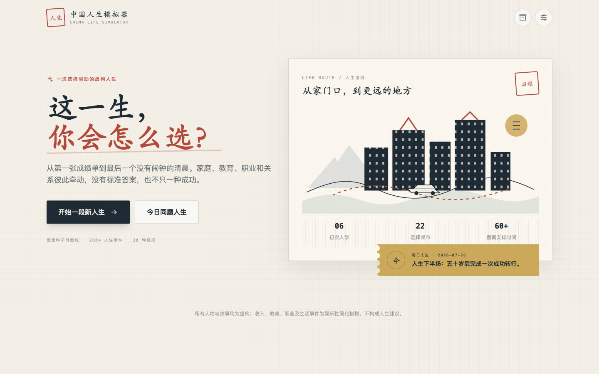
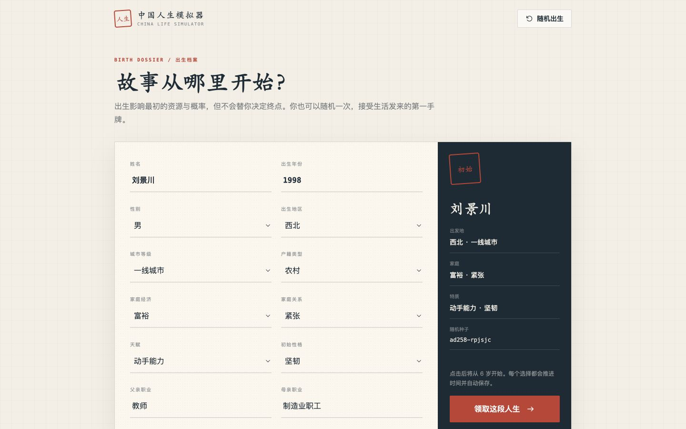
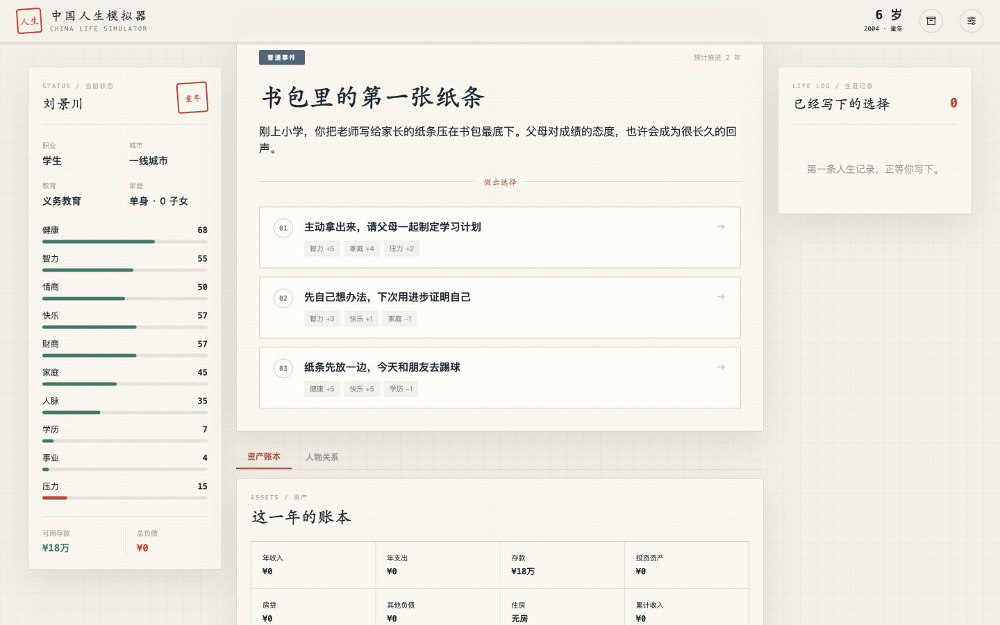
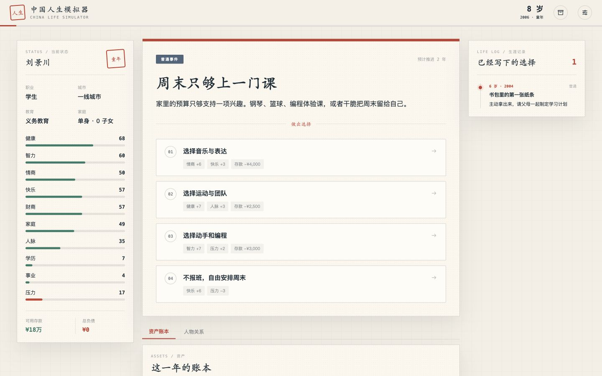
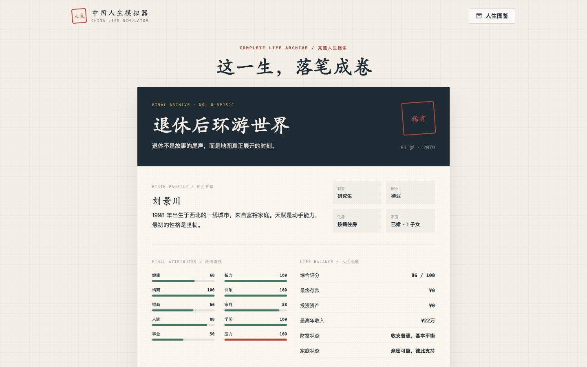
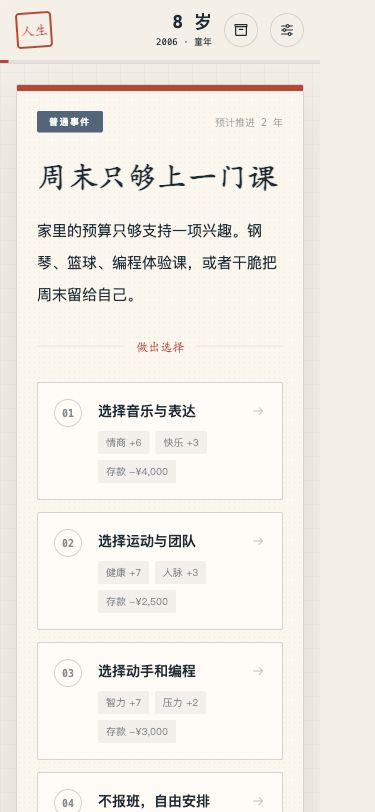

# China Life Simulator / 中国人生模拟器

[**中文文档（主要介绍）**](./README.zh-CN.md)

[](https://nextjs.org/)
[](https://www.typescriptlang.org/)
[](./LICENSE)
[](https://github.com/hql7-luo/china-life-simulator/actions/workflows/ci.yml)

[](https://vercel.com/new/clone?repository-url=https%3A%2F%2Fgithub.com%2Fhql7-luo%2Fchina-life-simulator)

A seedable, choice-driven browser game about education, work, money, family, and the many ways a life can unfold in contemporary China.



> **Online demo:** [china-life-simulator.vercel.app](https://china-life-simulator.vercel.app)

## Highlights

- Follow a complete life from age 6 to 80 through consequential choices.
- Replay any life with a deterministic seed or take the shared daily challenge.
- Explore 280 events across ordinary life, education, careers, family, regions, and hidden turns.
- Unlock 30 endings, 24 achievements, and 14 playable career paths.
- Track attributes, savings, debt, housing, investments, relationships, education, and career history.
- Keep progress locally and export the final life report as a PNG.
- Play comfortably on desktop, tablet, or mobile, with no account or backend required.

## Screenshots

| Birth setup                                                | Event gameplay                                                 |
| ---------------------------------------------------------- | -------------------------------------------------------------- |
|  |  |

| Assets and timeline                                                 | Final report                                             |
| ------------------------------------------------------------------- | -------------------------------------------------------- |
|  |  |

<p align="center">
  
</p>

## Tech Stack

| Area            | Technology                                        |
| --------------- | ------------------------------------------------- |
| Framework       | Next.js 15 App Router                             |
| UI              | React 18, TypeScript, Tailwind CSS, Framer Motion |
| State and saves | Zustand with localStorage persistence             |
| Report export   | html-to-image                                     |
| Quality         | ESLint, TypeScript, Vitest, GitHub Actions        |
| Hosting         | Vercel-ready static Next.js application           |

## Quick Start

Requirements: Node.js 22.13 or newer.

```bash
git clone https://github.com/hql7-luo/china-life-simulator.git
cd china-life-simulator
npm install
npm run dev
```

Open [http://localhost:3000](http://localhost:3000).

The repository also includes a `pnpm-lock.yaml`; CI uses pnpm for reproducible installs.

## Quality Checks

```bash
npm run lint
npm run test
npm run build
```

Release validation on 2026-07-28:

- TypeScript: passed with zero type errors
- ESLint: passed with zero warnings or errors
- Vitest: 4 test files, 24 tests passed
- Next.js production build: passed; the main route is statically generated
- Production dependency audit: no known vulnerabilities
- Browser QA: desktop, tablet, and mobile layouts passed with no horizontal overflow
- Critical flow: new life, choices through age 80, persisted save after refresh, and PNG report generation passed

GitHub Actions repeats install, lint, tests, and production build on pushes to `main` and pull requests.

## Game Content

| Content          | Count |
| ---------------- | ----: |
| Ordinary events  |   120 |
| Education events |    40 |
| Career events    |    50 |
| Family events    |    30 |
| Regional events  |    20 |
| Hidden events    |    20 |
| Endings          |    30 |
| Achievements     |    24 |
| Playable careers |    14 |

The simulation is intentionally fictional and simplified. Income, education, occupations, regions, and family choices are written for entertainment and do not represent personal, financial, or career advice.

## Project Structure

```text
app/                 Next.js entry points and global styles
components/          Screens, panels, game views, and UI primitives
data/                Events, jobs, achievements, endings, and daily challenge
game/                Selection, conditions, economy, effects, and scoring
store/               Persisted Zustand game state
tests/               Logic, content, storage, and state tests
docs/screenshots/    Release screenshots used in this README
```

## Deployment

Vercel should detect the repository as a Next.js project automatically:

1. Import `hql7-luo/china-life-simulator` in Vercel.
2. Keep the default framework and build settings.
3. Deploy; no environment variables are required.

The app stores saves only in the player's browser. It has no server database, user account, analytics SDK, or API key.

## Contributing

Focused fixes and carefully reviewed content improvements are welcome. Please run lint, tests, and build before opening a pull request.

## License

Released under the [MIT License](./LICENSE).
